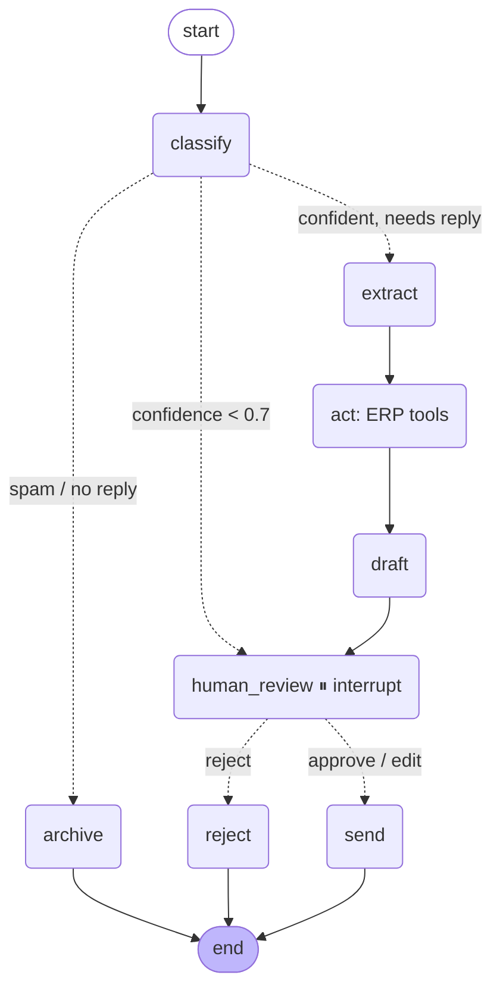

# InboxPilot: an AI inbox agent with human approval

**It classifies, extracts and drafts replies. A person approves before anything is sent.**

InboxPilot reads a business's incoming email (and optionally WhatsApp messages) and works out what each message needs: a quote, an order update, a complaint, an invoice, or nothing. It pulls out the details, checks the company's systems, drafts a reply in the business's tone, and then **waits for a person to approve, edit or reject it**. Only approved replies are sent.

It is built with **LangGraph** on **Google Gemini**, with a FastAPI backend and a Next.js review UI behind Google sign-in. The demo business is *Brightline Supplies*, a fictional B2B packaging supplier with a small SQLite "ERP".

## The graph



*(Exported with `graph.get_graph().draw_mermaid()`. The live version is under **View graph** in the UI and at `GET /api/graph`.)*

| Step | What happens |
|---|---|
| **Ingest** | Mock mode watches `data/inbox/` for `.eml`/`.json` files (no accounts needed). Gmail mode polls unread mail through the Gmail API. WhatsApp messages arrive through a Twilio sandbox webhook. |
| **Classify** | Gemini structured output (Pydantic): `quote_request` · `order_status` · `complaint` · `invoice` · `spam_other`, with a confidence and a reason. |
| **Extract** | An intent-specific Pydantic schema. For example, a quote request gives `items[{product, quantity}]`, delivery date, location, contact and company. |
| **Act** | Deterministic tool calls against the ERP: look up an order, fuzzy-match products and check stock, price with volume discounts, **generate a quote PDF**, create a complaint ticket, look up an invoice. |
| **Draft** | A reply in the business's tone, using only facts returned by the tools. |
| **Human-in-the-loop** | LangGraph `interrupt()`. The run pauses and the review UI shows the email, the extracted fields, the ERP facts and the editable draft. **Approve**, **edit then send**, or **reject**. |
| **Send** | Replies on the original channel: Gmail (in-thread, with the quote PDF attached), WhatsApp, or a real `.eml` file in `data/outbox/` in mock mode. |

## Reliability features

- **Checkpointing.** Every run is checkpointed in SQLite (`AsyncSqliteSaver`). A paused run waiting for review survives restarts, and a run that crashed half-way resumes from its last completed node, not from the start. *(Tested: `test_paused_run_survives_restart`.)*
- **Retries with backoff.** Every node that calls the LLM or a tool has a LangGraph `RetryPolicy` (3 attempts, exponential backoff with jitter). If a run still fails, the message is re-queued with backoff (1 min, then 4 min) and resumes from its checkpoint.
- **Dead-letter queue.** After 3 failed runs the message moves to `dead_letter` with the error. The UI has a Dead letter tab with a **Retry** button.
- **Confidence threshold.** A classification below `CONFIDENCE_THRESHOLD` (default 0.7) skips extraction and drafting entirely and goes straight to a person, with the reason shown.
- **Grounded drafts.** The draft prompt only receives tool results. Unknown products or missing quantities are surfaced as questions back to the customer instead of invented prices.
- **Audit trail.** Every step is logged per message (node, duration, output summary, errors, reviewer decision) and shown as a **Trace** timeline in the UI.
- **Tracing.** Set `LANGFUSE_PUBLIC_KEY` / `LANGFUSE_SECRET_KEY` and every run is traced in [Langfuse](https://langfuse.com), with each node and each Gemini call grouped per message.
- **Nothing is sent without approval.** `send` is only reachable from `human_review`, and the review API records who approved each reply and whether they edited it.

## Results

`make eval` runs classification and extraction over **30 labelled emails** (8 quote requests, 7 order-status questions, 7 complaints, 4 invoice emails, 4 spam/other) and writes [`evals/report.md`](evals/report.md).

<!-- RESULTS:START -->
_Run `make eval` to generate the numbers._
<!-- RESULTS:END -->

Extraction is scored per field against the gold labels. Quote line items are matched to catalogue SKUs and compared with quantities.

## Run it (mock mode: no email account needed)

Requirements: Docker, a [Gemini API key](https://aistudio.google.com/apikey) and a Google OAuth client for signing in to the review UI.

```bash
make setup    # creates .env with random secrets
# add GEMINI_API_KEY, GOOGLE_CLIENT_ID and GOOGLE_CLIENT_SECRET to .env
# (Google Cloud Console → Credentials → OAuth client → Web application,
#  redirect URI: http://localhost:3002/api/auth/callback/google)
make up       # = docker compose up --build -d
```

Open **http://localhost:3002**, sign in with Google, and click **Drop in 3 demo emails** (a quote request, an angry complaint and an order-status question). Within a few seconds each one appears under **Needs review** with its classification, extracted fields, ERP facts, quote PDF and draft.

You can also drop your own `.eml` or `.json` files into `data/inbox/` or upload them in the UI. `make demo` copies the three demo emails from the command line.

| | URL |
|---|---|
| Review UI | http://localhost:3002 |
| API docs | http://localhost:8002/docs |

## Gmail mode

1. In Google Cloud Console, enable the **Gmail API** and create an OAuth client of type **Desktop app**. Download it as `secrets/gmail_credentials.json`.
2. While the consent screen is in *Testing*, add the mailbox as a test user.
3. Run `make gmail-auth` once on your machine. A browser opens; approve access (`gmail.modify`). This writes `secrets/gmail_token.json`.
4. Set `INBOX_MODE=gmail` in `.env` and `make up`. InboxPilot polls `is:unread in:inbox -category:promotions` (change it with `GMAIL_QUERY`), marks ingested mail as read, and sends approved replies **in the same thread** with any quote PDF attached.

## WhatsApp (optional, Twilio sandbox)

1. Join the [Twilio WhatsApp sandbox](https://www.twilio.com/docs/whatsapp/sandbox) and set `TWILIO_ACCOUNT_SID`, `TWILIO_AUTH_TOKEN` and `TWILIO_WHATSAPP_FROM` (e.g. `whatsapp:+14155238886`).
2. Expose the API (e.g. `ngrok http 8002`), set `PUBLIC_BASE_URL` to the tunnel URL, and set the sandbox's *When a message comes in* webhook to `<PUBLIC_BASE_URL>/webhooks/twilio/whatsapp`.
3. Inbound messages are verified with Twilio's request signature, go through the same graph and review queue, and approved replies are sent back on WhatsApp.

## Tests

```bash
make test
```

23 tests: the full graph with a fake LLM (review → send with the PDF attached, edit, reject, low-confidence routing, spam archiving, **resume after restart**, **backoff → dead-letter**, recovery after a transient failure) and the ERP tools (product matching, discounts, lead times, order lookup, PDF generation).

## Project layout

```
inboxpilot/
  graph.py       LangGraph StateGraph: nodes, routing, RetryPolicy, interrupt
  runtime.py     poller + worker, checkpointer, review/resume, backoff + dead-letter queue
  schemas.py     Pydantic: classification, per-intent extraction, draft
  erp.py         SQLite ERP + tools (orders, stock, quote PDF, tickets, invoices)
  store.py       messages, per-step audit events, outbox
  sources/       mock folder · Gmail API · Twilio WhatsApp · channel-aware send
  api.py         FastAPI: review queue, review actions, demo loader, graph, quotes, Twilio webhook
  auth.py        Google ID token → app JWT
evals/           30 labelled emails + scorer → report.md
data/samples/    demo emails
ui/              Next.js review UI (Auth.js Google sign-in)
```

## Stack

Python 3.12 · LangGraph 1.x (StateGraph, `interrupt`, `RetryPolicy`, SQLite checkpointer) · LangChain + Google Gemini (structured output) · FastAPI · Pydantic · Gmail API · Twilio · Langfuse · ReportLab · Next.js 16 + Auth.js (Google) · Docker Compose
